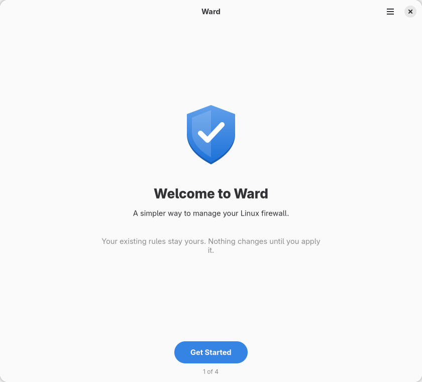
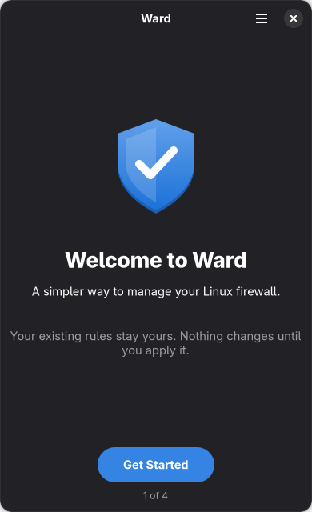
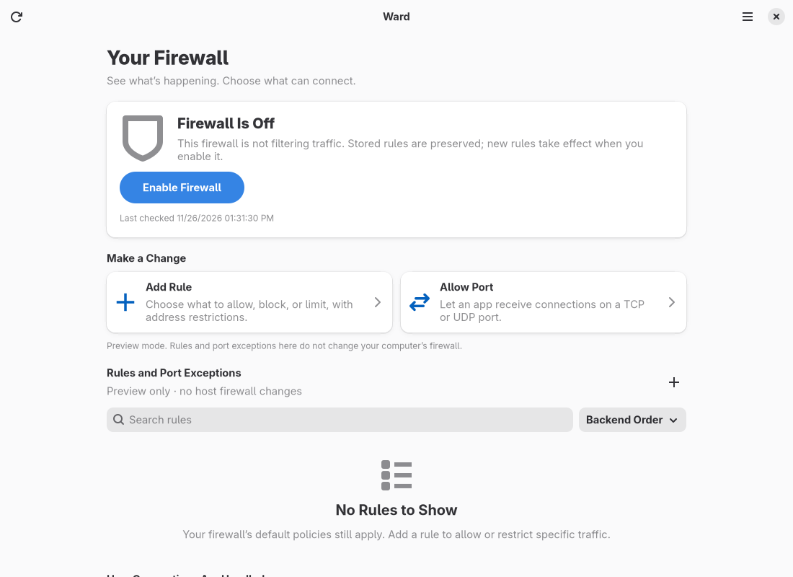
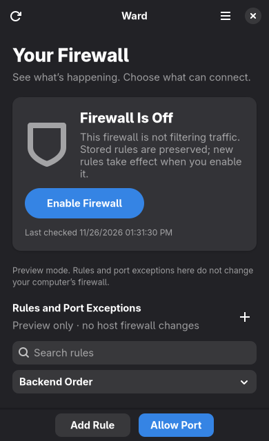
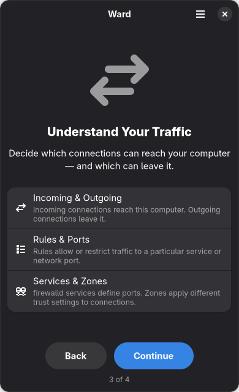
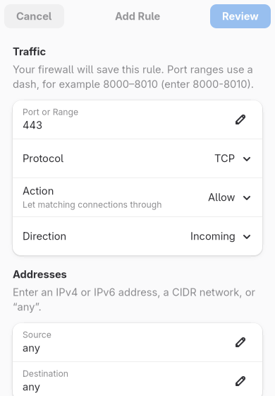
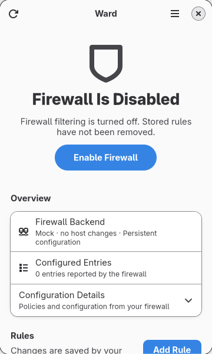
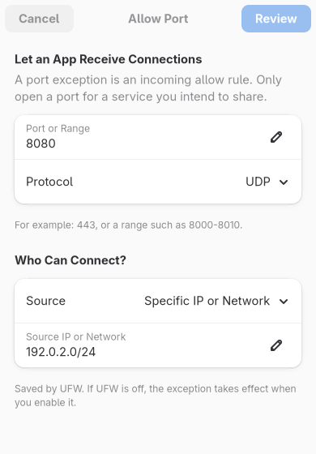

# Ward UI/UX refinement

The interface uses GTK4/libadwaita layouts, typography, semantic style classes, symbolic icons, adaptive dialogs, and native transitions. No custom CSS or new rendering framework was added. The existing authorization boundaries are preserved. The home redesign adds bounded firewalld rich-rule creation through its real D-Bus API, with validated fields rather than a free-form command editor.

## Review and changes

| Surface | Refinement and interaction checks |
| --- | --- |
| Main window | A compact status card explains on/off/unknown states and shows when status was checked. Add Rule and Allow Port appear as prominent home cards; at compact widths they move into a persistent bottom action bar. Rules appear ahead of technical details. Incoming and outgoing policy explanations use reported backend data, with no guessed defaults. |
| Welcome | The embedded Ward shield gives the welcome page a recognizable identity. All four steps have clear progress and consistent navigation. Back/Continue stay in a fixed footer at compact sizes, with deliberate focus movement. Secondary pages use native compact styling. The introduction can be exited directly when revisited. |
| Rule list | Search and sorting adapt at 550sp. Unknown configuration, inactive UFW, no entries, and no search results have different explanations. Clear Search restores results. Delete buttons have accessible labels and rule descriptions. Opaque firewalld identifiers are kept out of subtitles. |
| Rule editor | The header keeps Cancel and Review visible while fields scroll. Unsupported firewalld outgoing direction and UFW-style rate limits are omitted with a clear scope explanation. Firewalld custom rules can allow, block, or reject matching port traffic and restrict IPv4/IPv6 addresses. Empty/invalid ports cannot be submitted silently. Review includes source, destination, direction, protocol, and persistence scope. Canceling review preserves the editor and its values. |
| Allow Port | A focused incoming allow-rule form supports TCP/UDP, single ports/ranges, and UFW source restrictions. It explains who can connect and whether the exception is saved or runtime-only. Validation and cancel/apply paths use the real shared request boundary. |
| Confirmations | Explicit operation names replace “Apply Change.” Destructive changes use native destructive styling; cancellation remains the default. Concise headings fit native alert sizing. Source text is displayed without markup interpretation. |
| Preferences | General, Firewall, and Advanced pages separate appearance, backend configuration, and diagnostics. Changing the preferred backend rebuilds its capability controls without closing Preferences. Unknown/pending state disables mutation controls. Policy/logging dialogs display last-read values when available and require a deliberate choice if unknown; an unchanged choice cannot be submitted. Cancel never implies a change was applied. |
| Backend forms | UFW policy, logging, and profile forms and firewalld service, interface/source, save, and reload forms use the same native editor/review patterns. Source networks and interface names are validated. Mixed IP families and grammar-injection-like rule fields are rejected; rich-rule templates were also checked with the installed firewalld parser without applying them. Real-backend reviews were canceled during graphical tests. |
| Feedback | Pending operations have a spinner and readable activity text. Completed changes use operation-specific feedback after the backend returns. New feedback replaces old toasts. Refresh updates the dashboard/time without an unnecessary success popup. Errors invalidate mutation state and expose persistent recovery guidance through a banner and Details. |
| Logs | Loading, no entries, unavailable journal, and entries have distinct presentations. Refresh is disabled while loading; Copy is enabled only when actual entries are visible. Both functions remain asynchronous and preserve the existing journal command integration. |
| Diagnostics | Reports are selectable and can be copied or saved through GTK’s native file chooser. Connection errors are included when no snapshot is available. File writes use GIO’s asynchronous API and private file creation flags; cancellation is distinct from an error. |
| About/shortcuts | Both are discoverable from the primary menu. The shortcut reference covers refresh, add, search, Preferences, and dialog dismissal. Root shortcuts cannot open another editor over an existing modal dialog. |

## Appearance and accessibility

- The dashboard is clamped on wide windows; search/sort stack vertically on narrow ones, with creation actions always reachable in the compact bottom bar. The window supports 360px width and scrolling at short heights.
- Appearance uses the system style by default, with optional light/dark overrides. Native high-contrast styling is preserved.
- Forward/back onboarding transitions and state crossfades are brief. Both the app preference and the live `gtk-enable-animations` setting gate transitions; disabled motion sets their duration to zero. Dialogs retain libadwaita’s own accessibility behavior.
- Standard widgets provide keyboard navigation. Icon actions have accessible labels; form validation uses an alert role. Colors are never the only indicator of firewall state.
- Enter activates the native default form action; destructive review defaults to Cancel. Modal actions preserve focus and input.

Design references: [GNOME HIG](https://developer.gnome.org/hig/), [primary menus](https://developer.gnome.org/hig/patterns/controls/menus.html), [placeholder pages](https://developer.gnome.org/hig/patterns/feedback/placeholders.html), and [libadwaita adaptive layouts](https://gnome.pages.gitlab.gnome.org/libadwaita/doc/main/adaptive-layouts.html).

## Screenshots

These are captures of actual GTK windows using the explicit preview backend, with temporary preferences. They do not represent host firewall state.

| Welcome, light / wide | Welcome, dark / compact |
| --- | --- |
|  |  |

| Dashboard, light / wide | Dashboard, dark / compact |
| --- | --- |
|  |  |

| Security overview, compact | Rule editor, compact |
| --- | --- |
|  |  |

The minimum-width layout also uses native high-contrast colors and borders:



The short port-exception editor:



## Reproduce the checks

A graphical Wayland or X11 session, the documented native dependencies, and a compiled GSettings schema are required:

```sh
glib-compile-schemas --strict data
GSETTINGS_SCHEMA_DIR="$PWD/data" GSETTINGS_BACKEND=memory G_DEBUG=fatal-warnings \
  cargo test --locked -- --ignored

# Repeat using libadwaita's supported high-contrast debug setting.
ADW_DEBUG_HIGH_CONTRAST=1 GSETTINGS_SCHEMA_DIR="$PWD/data" \
  GSETTINGS_BACKEND=memory G_DEBUG=fatal-warnings cargo test --locked -- --ignored

# Optional actual-window PNG captures from both graphical workflows.
WARD_UI_CAPTURE_DIR=/tmp/ward-ui-review GSETTINGS_SCHEMA_DIR="$PWD/data" \
  GSETTINGS_BACKEND=memory cargo test --locked -- --ignored

cargo fmt --check
cargo clippy --all-targets --locked -- -D warnings
cargo test --all-targets --locked
cargo test --no-default-features --locked
cargo build --release --locked
```

The graphical tests exercise onboarding, compact/wide light/dark styling, 360px sizing, valid/invalid rule entry, canceled and accepted mock changes, search, deletion, settings, live reduced motion, logs, copy actions, diagnostics, About, shortcuts, backend forms, unknown/current policy values, disabled controls, and failure recovery. GTK warnings are treated as test failures. They never authorize a real backend mutation.

Release validation still needs screen-reader and physical keyboard review, large text across desktop font configurations, native save-chooser/portal acceptance and cancellation, real journal permissions, and UFW/firewalld authorization in disposable VMs. The graphical tests inspect the save control but do not automatically operate an external desktop file chooser. The existing backend feature limits remain documented in the main README; this refinement does not make a new claim of production security or Flathub readiness.

The bounded custom-rule templates follow the [firewalld rich language](https://firewalld.org/documentation/man-pages/firewalld.richlanguage.html) and [addRichRule D-Bus API](https://firewalld.org/documentation/man-pages/firewalld.dbus.html). Host netfilter changes were not used as an automated test.
